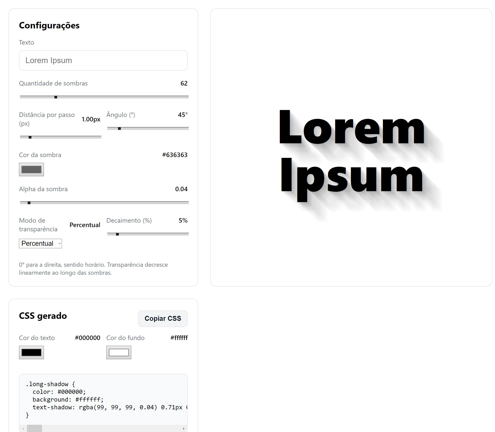

Link do projeto online: https://everctba.github.io/long-shadow-css-generator/

## Cores como variáveis CSS

No seletor **"Cores no CSS gerado"** (painel da direita) dá para exportar o efeito
com as cores em variáveis CSS, em vez de valores fixos:

- **Variáveis CSS (color-mix)** — padrão. O bloco gerado expõe `--shadow-color`,
  `--text-color` e `--bg-color`; a sombra usa
  `color-mix(in srgb, var(--shadow-color) X%, transparent)` para aplicar o alpha de
  cada passo. Trocar a cor depois é editar uma linha.
- **Variáveis CSS (canais RGB)** — expõe `--shadow-rgb: r, g, b` e usa
  `rgba(var(--shadow-rgb), alpha)`. Compatibilidade máxima (funciona em navegadores
  sem `color-mix`).
- **Valores fixos (rgba)** — comportamento antigo, sem variáveis.

Os três modos produzem exatamente o mesmo resultado visual. No modo `em` (proporcional),
`--shadow-scale` continua funcionando junto das variáveis de cor.
