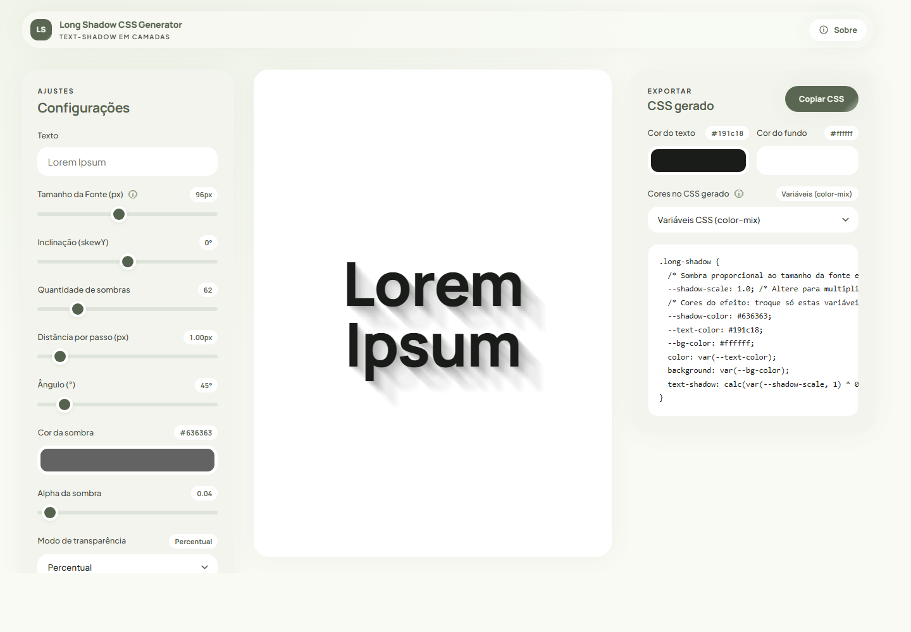
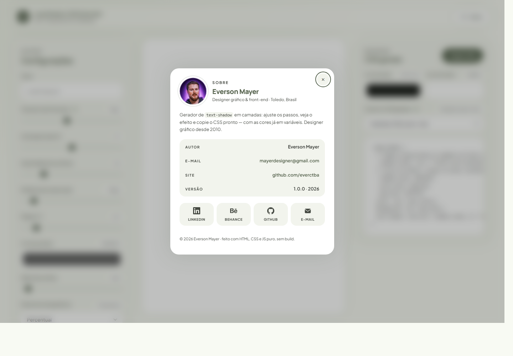
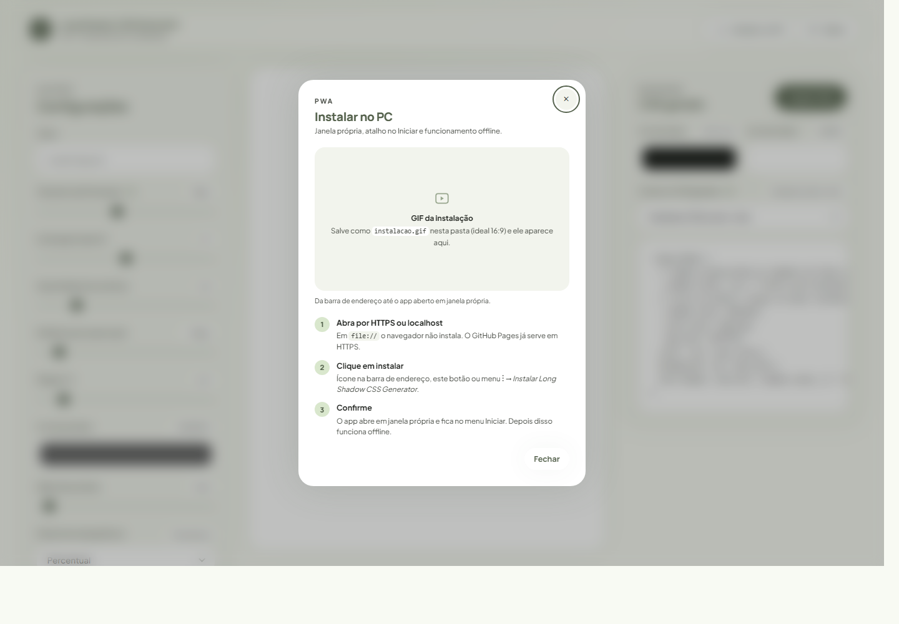
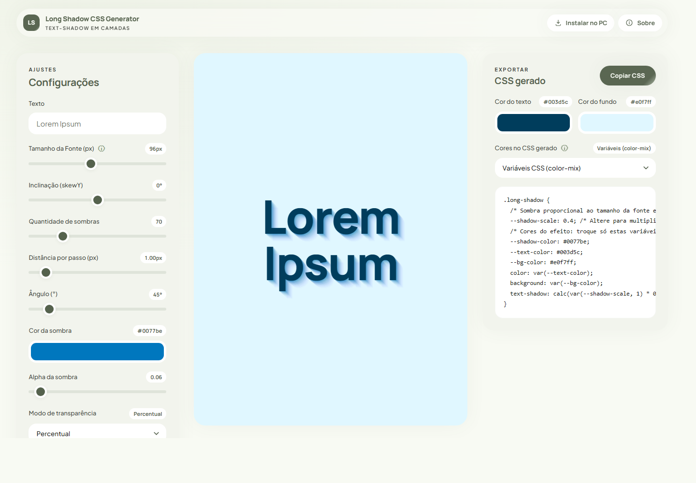

Link do projeto online: https://everctba.github.io/long-shadow-css-generator/

Gerador de `text-shadow` em camadas: ajuste os passos, veja o efeito no palco e copie o
CSS pronto — com as cores já em variáveis.

## Cores como variáveis CSS

No seletor **"Cores no CSS gerado"** (painel da direita) dá para exportar o efeito
com as cores em variáveis CSS, em vez de valores fixos:

- **Variáveis CSS (color-mix)** — padrão. O bloco gerado expõe `--shadow-color`,
  `--text-color` e `--bg-color`; a sombra usa
  `color-mix(in srgb, var(--shadow-color) X%, transparent)` para aplicar o alpha de
  cada passo. Trocar a cor depois é editar uma linha.
- **Variáveis CSS (canais RGB)** — expõe `--shadow-rgb: r, g, b` e usa
  `rgba(var(--shadow-rgb), alpha)`. Compatibilidade máxima (funciona em navegadores
  sem `color-mix`).
- **Valores fixos (rgba)** — comportamento antigo, sem variáveis.

Os três modos produzem exatamente o mesmo resultado visual. No modo `em` (proporcional),
`--shadow-scale` continua funcionando junto das variáveis de cor.

## Interface

A interface segue o design system em [`DESIGN.md`](./DESIGN.md). Os tokens ficam no
`:root` do `index.html` (superfícies, `--primary`, raios, sombra ambiente e movimento),
então trocar a paleta é editar só aquele bloco. A página é estática e não tem build.

A faixa superior traz o nome do projeto e o botão **Sobre** (canto direito), que abre um
modal com autor, e-mail, site, versão e os links de LinkedIn, Behance, GitHub e e-mail —
com a foto de perfil em `fotoever.jpeg`, recortada em círculo (`border-radius: 50%`;
se o arquivo faltar, o modal mostra as iniciais).

## PWA — instalar no PC

Mesmo sendo HTML/CSS/JS puro, o app é instalável e funciona offline. Arquivos:

- `manifest.webmanifest` — nome, ícones, cor do tema e `display: standalone`;
- `sw.js` — service worker que guarda o app shell em cache (offline) e as fontes do Google
  em *stale-while-revalidate*;
- `icones/` — 192, 512, maskable 512, Apple touch 180 e favicon 32.

**Como instalar:** publique em HTTPS (o GitHub Pages já serve assim) ou rode em
`http://localhost` — em `file://` o navegador não registra service worker. No Chrome/Edge,
use o ícone de instalação na barra de endereço, o botão **Instalar no PC** da faixa
superior (abre um modal com o passo a passo) ou o menu ⋮ → *Instalar Long Shadow CSS
Generator*. Instalado, o app abre em janela própria, sem barra de endereço.

O modal **Instalar no PC** reserva uma área para o GIF da demonstração: salve o arquivo
como `instalacao.gif` na raiz do projeto e ele aparece no lugar do placeholder
automaticamente (não precisa mexer no código nem no manifest).

**Ao publicar mudanças:** troque `VERSAO` no topo de `sw.js` (ex.: `v1.0.1`) para renovar o
cache — a navegação é rede-primeiro, os arquivos estáticos são cache-primeiro.

## Presets

Os 8 temas da coluna de ajustes aplicam cor de fundo, cor do texto, cor da sombra, alpha,
quantidade, distância, ângulo, modo de transparência e decaimento de uma vez; o preset
**Oceano** também define a escala do efeito (`--shadow-scale: 0.4`).

